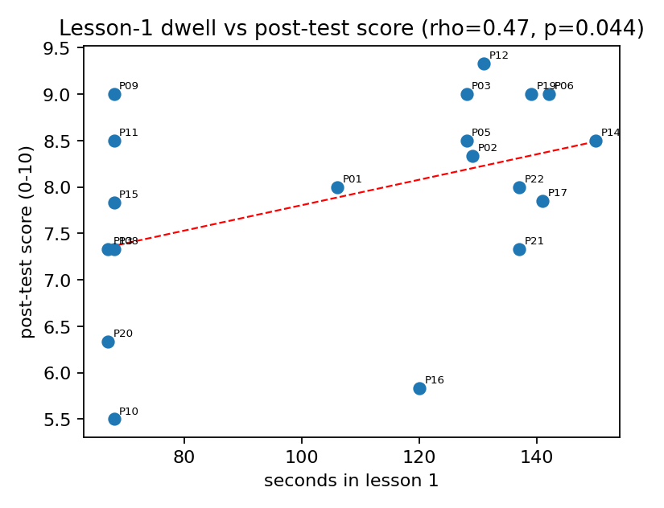
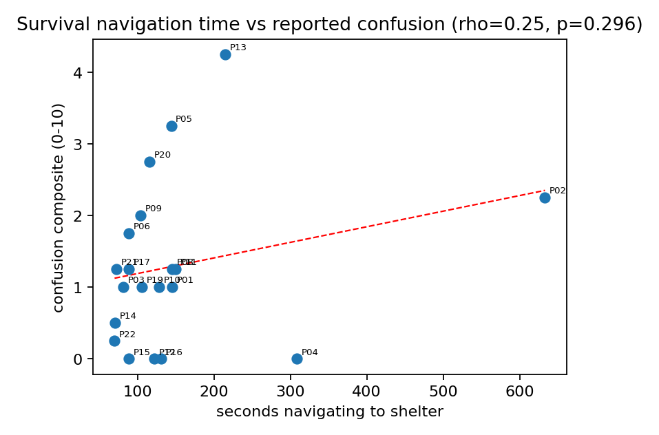
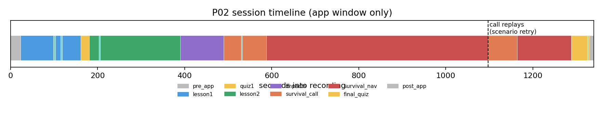

# Storm — Capstone Analysis (RQ2)

**Storm** is an interactive Unity VR program that teaches tornado formation,
tornado geography ("Tornado Alley"), and shelter-seeking behavior through a
real-time 3D simulation. This repository contains the analysis pipeline for
the second research question of our group capstone:

> **RQ2:** Which explainable behavioral features are indicative of cognitive
> engagement and confusion in immersive VR learning environments?

**Key constraint:** the app produced no in-app telemetry logs. The behavioral
data source is a set of **Zoom screen recordings** of each session —
fullscreen app footage, a webcam overlay of the participant, and Zoom
auto-transcripts (.vtt) of the app narration and post-session interviews.

---

## Data

| Source | Contents |
|---|---|
| 20 local session recordings (MP4 + VTT) + P01 professor-supplied aggregates | recovered from a damaged 5 GB zip via stream-level extraction; P01 added manually (no local media) |
| Pre-survey | demographics + 10 knowledge questions (K1–K10) |
| Post-survey 1 | same 10 knowledge items + GUESS game-experience scale + cognitive-load scale |
| Post-surveys 2a/2b | interviewer rapport + AI-interviewer trust |

**21 participants** are in the labeled analysis: 20 local recordings plus
P01 (professor-supplied features/survey; no local MP4/VTT). P07's
recording is truncated mid-session with no transcript.

Raw recordings, survey exports, and the participant name map are **not in
this repository** — they contain PII and participant faces. Only code and
de-identified derived data (PIDs only) are committed.

## Pipeline

| Script | What it does |
|---|---|
| `extract_zip.py` | Recovers MP4/VTT entries from the damaged archive (broken central directory → scans local headers) |
| `pilot_segment.py` | Single-video segmentation proof-of-concept (P08) |
| `segment_sessions.py` | Fuses VTT narration landmarks + 1-fps frame signatures → per-second phase labels per session; handles restarts, transcript gaps, missing transcripts; caches frame signatures + webcam motion |
| `extract_features.py` | Timing, retries, quiz correctness, speech, webcam motion/stillness → `data/features.csv` (plus P01 manual row) |
| `extract_face.py` | **ML face analysis** — MediaPipe FaceLandmarker on the webcam overlay → head pose (yaw/pitch/roll) + 16 facial action units (blendshapes) per second |
| `build_labels.py` | Survey → engagement, confusion, knowledge scores → `data/labels.csv` (incl. P01/P17 manual rows) |
| `explore.py` | Feature–label Spearman correlation screen → `data/explore_correlations.csv` |
| `model_rq2.py` | LASSO + leave-one-out CV; binary logistic for confusion flag → `data/model_coefficients.csv` |
| `make_figures.py` | Report figures → `figures/` |
| `make_pca.py` / `make_expr_timeline.py` | PCA profiles + P02 expression timeline → `figures/` |
| `verify.py` / `verify_transcripts.py` | Independent audits: 52 artifact checks + 62 transcript checks → exit non-zero on failure |

Every session is segmented into:

```
pre_app → lesson1 → quiz1 → lesson2 → impacts → survival_call
        → survival_nav → final_quiz → post_app → interview
```

## Findings

### 1. Dwell time on lesson content predicts knowledge gain

Lesson-1 duration is bimodal (~68s vs ~130s). The extra ~70s is time
participants spent on "Next →" transition screens — deliberate pacing, not
different app builds. Participants who lingered scored ~0.8 points higher
on the post-test (Spearman ρ=0.47, p=.044, n=19).



### 2. Survival navigation is the dominant friction point

Time to reach the basement shelter varies 70–633s — by far the
highest-variance behavior in the dataset (all narrated phases are
near-constant). Post-session interviews corroborate it: participants
independently describe navigation/controls as confusing
("the instructions were a little bit unclear", "the controls being
difficult and clunky", "I didn't know I was playing the game, I was just
staring at the screen").



### 3. Case study — a complete confusion episode (P02)

Normal lessons → survival call → **~8.5 min of failed navigation** → the
scenario auto-restarts the phone call → second attempt → final quiz →
elevated reported confusion. The replayed dialogue appears verbatim in
the transcript.



### 4. ML head-pose features correlate with engagement/effort

MediaPipe FaceLandmarker estimates head yaw/pitch per second from the
webcam overlay. Participants whose pose deviated from their own median
(looking away) reported **less effort** (ρ=−0.57, p=.008) and trended
toward **less engagement** (ρ=−0.40, p=.085) — a visible-disengagement
signal in the expected direction, strongest for effort.

### 5. Facial expression dynamics track confusion

The same FaceLandmarker pass records 16 facial action units per second.
Session-level aggregates show **frowning** (ρ=+0.56, p=.010) and
**mouth-stretch** (ρ=+0.52, p=.018) activation co-occurring with
reported confusion — the expected direction. The largest |ρ| in the
dataset is brow-raise-max vs complexity (−.75), but it is a
fragile max-statistic on ~90 px faces and is reported as a hypothesis
only. Webcam faces are small, so these are noisy proxies, not emotion
labels.

### 6. Honest null on prediction

At n=21 with session-level self-report labels, a LASSO model cannot
predict engagement/confusion better than the mean (LOO R² < 0; engagement
−0.17, confusion −0.11, confusion_any 0.67 vs 0.76 baseline). The
associations above are descriptive and hypothesis-generating — a finding
that argues for per-phase experience sampling and larger cohorts in
future work.

## Repo layout

```
data/        de-identified derived CSVs (labels, features, correlations)
figures/     report figures (PNGs above)
recovered/   raw videos + transcripts   [gitignored - PII]
out/         per-second timelines, framesig caches, contact sheets [gitignored]
*.py         pipeline scripts (table above)
capstone prop.pdf   original project proposal
RQ2_findings.md     detailed analysis write-up
VERIFICATION.md     independent audit report (114 checks)
REPRODUCIBILITY.md  full reproduction appendix
data/DATA_DICTIONARY.md  column definitions
```

## Reproduce

Requires Python 3.10+, `opencv-python`, `pandas`, `numpy`, `matplotlib`,
`scikit-learn`, `scipy`, `mediapipe`. `extract_face.py` also needs
`face_landmarker.task` in the repo root (download URL in the script docstring). Place the MP4/VTT pairs in `recovered/` and a
`data/participants.csv` mapping (`participant_id`, `recording_file`), then:

```bash
python segment_sessions.py    # ~1s/frame decode, cached to out/
python extract_face.py       # needs face_landmarker.task -> out/*_face.csv, *_blend.csv
python extract_features.py    # -> data/features.csv
python build_labels.py        # -> data/labels.csv (needs survey xlsx)
python explore.py             # correlations
python model_rq2.py           # LASSO + LOO-CV
python make_figures.py        # figures/
python verify.py              # 52 artifact checks (must pass)
python verify_transcripts.py    # 62 transcript checks (must pass)
```

P01 is not in `data/participants.csv`; `extract_features.py` and
`build_labels.py` inject it via `MANUAL_FEATURE_ROWS` /
`MANUAL_LABEL_ROWS` because the professor supplied aggregates but not
the video/transcript.

*Capstone project — Ashik Dey Rupak (RQ2) & Shalin Bhattarai (RQ1).*
