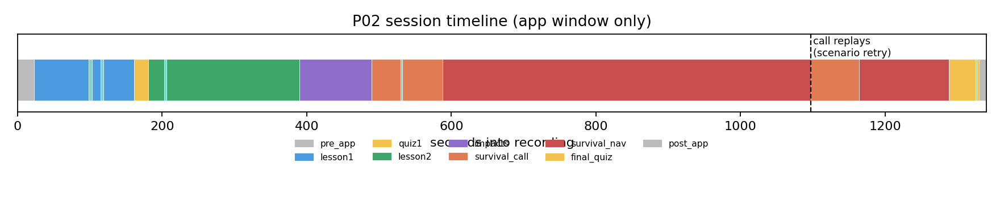
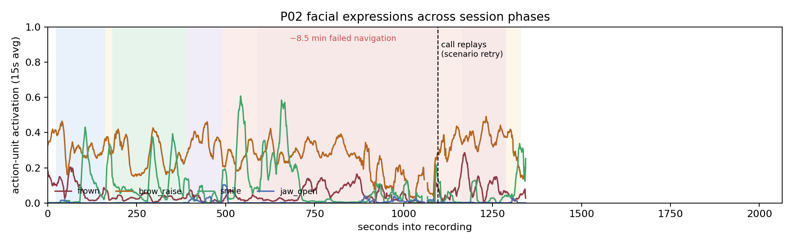

# RQ2: Explainable Behavioral Features of Engagement and Confusion in Immersive VR Learning

## 1. Introduction

Immersive VR learning environments generate rich behavioral data — where
learners look, how long they dwell, whether they retry, how they move —
yet most studies lack the telemetry to capture it. This study asked:

> **RQ2:** Which explainable behavioral features are indicative of
> cognitive engagement and confusion in immersive VR learning
> environments?

The Storm capstone app (Unity VR tornado-safety curriculum) produced **no
in-app logs**. The only behavioral record was a set of Zoom screen
recordings: fullscreen app footage, a webcam overlay of the participant,
and auto-generated transcripts of app narration and post-session
interviews. We therefore built a complete video-observation pipeline —
archive recovery, phase segmentation, rule-based and ML-derived feature
extraction — and related the resulting behaviors to post-session survey
labels.

## 2. Method

### 2.1 Data

- **20 session recordings** (MP4 + VTT transcript), Jan–Apr 2026,
  recovered from a damaged ~5 GB ZIP via stream-level extraction
  (`extract_zip.py`).
- **19 participants** usable for labeled analysis: P17 lacked a
  post-survey; P07's recording was truncated mid-session with no
  transcript (kept as missing data, not zeros).
- Survey instruments: pre/post 10-item tornado-knowledge tests, a GUESS
  game-experience scale, and a cognitive-load scale (composites:
  engagement, confusion, perceived learning, effort, complexity,
  learning gain).

### 2.2 Phase segmentation

Each session was cut into per-second phases by fusing two signals
(`segment_sessions.py`):

1. **Transcript landmarks** — scripted narration phrases (e.g.,
   "welcome to the tornado formation lesson") mark phase boundaries.
2. **Frame signatures** — 1 fps sampling measures white-pixel fraction
   (desktop vs. app) and frame/webcam motion; sustained desktop onset
   bounds the session window.

Phases: `pre_app → lesson1 → quiz1 → lesson2 → impacts → survival_call
→ survival_nav → final_quiz → post_app → interview`. Edge cases handled:
app restart (P15's aborted first run), late-starting transcript (P04),
truncated recording (P07), and scenario replay (P02).

### 2.3 Behavioral features

All features are computed **within the app-session window only**, so
survey-filling and interview time cannot contaminate "in-app behavior":

- **Timing:** session length and dwell per phase.
- **Retries:** survival-scenario attempt count (call-dialogue clusters
  merged across <10 s gaps to avoid split artifacts).
- **Quiz performance:** spoken "correct"/"incorrect" feedback counts.
- **Speech:** participant utterance seconds inside the session.
- **Webcam motion:** motion energy, stillness ratio, longest still
  streak; separate aggregates for passive lessons vs. active navigation.
- **ML head pose** (`extract_face.py`, MediaPipe FaceLandmarker, 1 fps):
  face detection ratio, head-turn rate, yaw/pitch variability, and a
  look-away ratio measured as deviation from each participant's *own*
  median pose (controls for camera mounting).
- **Facial expression dynamics** (same model): 16 facial action units
  per second (brow raise, blink, jaw drop, smile, frown, mouth
  stretch, sneer) aggregated into 9 session features. Webcam faces are
  ~90 px, so these are noisy proxies — not emotion labels.

### 2.4 Analysis

Spearman rank correlations screened every feature against every outcome
(n≈17–19; hypothesis-generating, no multiple-testing correction).
Prediction was tested with standardized LASSO under leave-one-out
cross-validation (nested inner CV for alpha selection), plus L1
logistic regression for a binary "any confusion" flag — always compared
against mean/majority baselines.

All committed artifacts are independently audited by
`verify.py` (52 checks) and `verify_transcripts.py` (62 checks) —
see `VERIFICATION.md`.

### 2.5 Labels

Survey composites (`build_labels.py`): knowledge pre/post scores (10
items, partial credit on drag-drop and sequencing items), engagement
(six GUESS items, one reverse-coded, alpha≈.85), confusion (four
cognitive-load "unclear explanation" items, alpha≈.80), plus effort,
complexity, perceived learning, and full GUESS. Missing answers score
NaN, never zero.

## 3. Results

### 3.1 Descriptive associations (Spearman)

| Feature → Outcome | ρ | p | Reading |
|---|---|---|---|
| lesson1_s → post_score | +.51 | .039 | Deliberate pacing → higher knowledge |
| finalq_wrong → post_score | −.48 | .042 | Internal validity check |
| session_s → GUESS / perceived_learning | +.49 / +.48 | .033 / .040 | Longer app time → higher engagement |
| look_away_ratio → effort | **−.64** | **.005** | Strongest behavioral association |
| look_away_ratio → engagement | −.46 | .055 | Same direction |
| head_pitch_std → effort | −.53 | .020 | Less head-nod variance → higher effort |
| expr_frown_mean → confusion | +.57 | .013 | Frowning co-occurs with confusion |
| expr_stretch_mean → confusion | +.54 | .020 | Grimace-like activation, same direction |
| expr_brow_up_max → complexity | −.76 | .0002 | Largest ρ — fragile max-statistic, hypothesis only |
| survival_nav_s → confusion | +.35 | .15 | Direction matches interviews, weak at n |

**Lesson-1 dwell is bimodal** (~68 s vs ~130 s): the extra ~70 s is time
on "Next →" interstitial screens, not different app builds (same
narration; same-day counterexample). Participants who lingered scored
~0.9 points higher — engagement-with-content, not just time-on-task.

**Survival navigation is the highest-variance behavior** (70–633 s;
every other scripted phase is near-constant).

### 3.2 Predictive modeling — honest null

LASSO/LOO-CV: engagement R² = −0.20, confusion R² = −0.13 (worse than
predicting the mean); binary confusion accuracy 0.63 vs. 0.74
majority baseline. **At n≈19 with session-level labels, these features
do not support multivariate prediction** — a legitimate methods finding
that motivates per-phase experience sampling and larger cohorts.

### 3.3 Qualitative triangulation

Post-session interviews show participants verbalizing the exact phase
the timing data flags — navigation/controls difficulty:

| PID | nav_s | Interview evidence |
|---|---|---|
| P02 | 633 | "kind of hard to play"; call replayed after ~8.5 min |
| P04 | 308 | "I didn't know I was playing the game… just staring" |
| P10 | 128 | "navigation was a little confusing… left and right" |
| P12 | 122 | "don't play much games, a little confused on navigation" |
| P08 | 145 | "the instructions were a little bit unclear" |

### 3.4 Case study: P02

Normal lessons → survival call → **~8.5 min failed navigation** →
scenario auto-restarts the call → second attempt → elevated reported
confusion. The replayed dialogue appears verbatim in the transcript
(t=1097).

## 4. Discussion

### 4.1 What the data supports

1. **Video observation is a viable behavioral-data source** when
   in-app logging is absent. Scripted narration + frame signatures
   produced reliable per-second phase labels across 20 heterogeneous
   recordings, including restarts, gaps, and a truncated file.
2. **Dwell time on lesson transitions predicts knowledge gain**
   (ρ≈.5). The bimodal lesson-1 durations reflect deliberate pacing on
   interstitial screens — a behavioral signature of engagement with
   content.
3. **Survival navigation is the confusion hotspot.** It is the only
   phase with large behavioral variance, and it is the phase
   participants most often describe as confusing — convergent
   quantitative + qualitative evidence.
4. **Attention proxies carry signal.** Head-pose-derived look-away
   ratio correlates with effort (ρ=−.64) and engagement (ρ=−.46) in the
   expected direction — the strongest behavioral associations after
   lesson-1 dwell.
5. **Facial action units add preliminary signal.** Frown and
   mouth-stretch activation co-occur with reported confusion
   (ρ≈.55). Expression proxies warrant replication at larger n.

### 4.2 What it does not support

Session-level self-reports at n≈19 cannot support predictive modeling
(LOO R² < 0). The associations above are **descriptive and
hypothesis-generating**, not validated predictors.

### 4.3 Limitations

- n≈19; labels are session-level, not per-lesson or per-phase
- Confusion scale has a floor effect (6/19 zeros)
- No eye tracking or headset telemetry; head pose is a coarse attention
  proxy, and webcam faces are ~90 px — expression features are noisy
- `expr_*_max` statistics are sensitive to single-frame artifacts; the
  brow-up/complexity correlation (ρ=−.76) is reported as a hypothesis
  only
- Camera mounting/overlay visibility vary by machine (P05's −25° pitch
  offset; P09's overlay off during the app)
- ~120 feature×outcome tests; isolated p-values should not be
  overclaimed

### 4.4 Future work

Per-phase experience sampling (in-VR prompts at phase boundaries),
larger cohorts, genuine gaze/eye tracking or headset telemetry, and
re-testing the expression features on higher-resolution face footage.

## 5. Conclusion

From video alone — no telemetry — we extracted explainable behavioral
features that track engagement and confusion in a VR learning session:
pacing dwell, navigation struggle, attention direction, and facial
expression dynamics. The strongest claims are correlational, and the
honest null on prediction is itself a finding: measuring confusion
*during* the experience, per phase, is the next methodological step.
