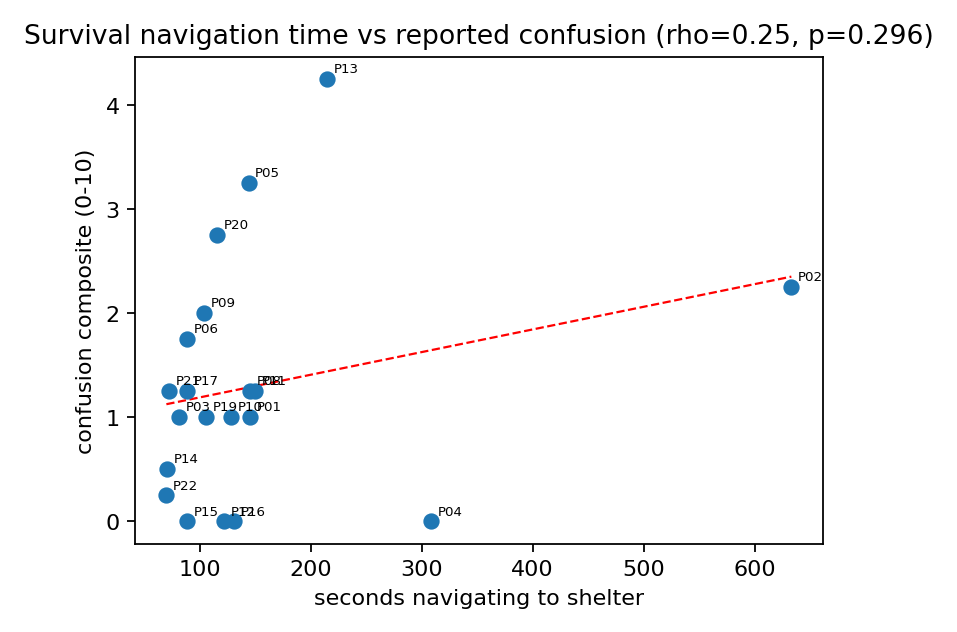

# Storm: Finding Explainable Behavioral Signs of Engagement and Confusion in a VR Learning Program

*Ashik Dey Rupak — Capstone Report (RQ2)*

## 1. Detailed Description of My Capstone Experience

For my capstone project, I worked on Storm, an interactive Unity virtual-reality program that teaches how tornadoes form, where they happen, and how to stay safe. Storm was a joint capstone with my partner Shalin Bhattarai. We shared the same VR system, but each of us owned a separate research question. Shalin studied whether spatial and timing patterns inside the simulation could predict learning outcomes. My research question, RQ2, asked which explainable behavioral features are most indicative of cognitive engagement and confusion in immersive VR learning environments.

The project started from a written proposal that assumed the Storm app would produce detailed in-app telemetry logs — timestamps of where each learner looked, which objects they touched, and how long they spent in each part of the simulation. When I began the analysis work, I discovered that the app had actually been run without any of that logging enabled. There were no interaction logs, no event timestamps, and no in-app behavior records at all. The only behavioral record of each session was a set of Zoom screen recordings: one video per participant showing the fullscreen VR application, a small webcam overlay of the participant in the corner, and a Zoom auto-generated transcript of the narration and the post-session interview.

That discovery changed the whole shape of my project. Instead of analyzing clean event logs, I had to treat twenty screen recordings as my dataset. Each recording was roughly an hour of compressed video, and the behavioral signals I wanted — how long someone spent in each lesson, whether they looked away, how still they sat, whether they were frowning — were all locked inside pixels. My job became building a pipeline that could recover those signals from video and transcripts, join them to survey-based labels of engagement and confusion, and then ask honestly what the data could and could not support.

The first major obstacle was the data itself. All the recordings had been shared as one large ZIP archive of about five gigabytes, and the archive was damaged — its central directory was corrupt, so every standard unzip tool failed. I wrote a custom extractor that scanned the raw bytes for local file headers, recorded each entry's offset, and copied the data regions directly out of the archive, carefully handling the data descriptors that mark where each file ends. That script recovered twenty MP4 and VTT pairs that would otherwise have been lost.

Once the recordings were recovered, the next step was turning them into structured data. Zoom's auto-transcripts contain narration cues with timestamps, and phrases like "welcome to the tornado formation lesson" act as landmarks for each phase of the session. I wrote a segmentation script that fused those transcript landmarks with a per-second frame signature — mostly detecting when the screen shows the white Zoom desktop, which marks the end of the app portion — to divide each recording into phases: pre-app, lesson one, quiz one, lesson two, the impacts lesson, the survival phone call, survival navigation, the final quiz, and the post-app interview. Some sessions broke the assumptions: one participant restarted the app mid-recording, one transcript started four minutes late, one recording was truncated with no transcript at all, and one participant replayed the survival scenario after failing it. Each of these cases had to be detected and handled explicitly rather than averaged away.

For labels, I processed three survey exports. The pre-survey gave a ten-item knowledge score. The post-surveys gave the same knowledge items plus a game-experience scale called GUESS and a cognitive-load scale. I built composites for engagement and confusion, reverse-coded the item where agreement actually meant less engagement, fuzzy-matched participant names between surveys and recordings because of typos on both sides, and even handled a misspelled survey label ("strongy agree") that would otherwise have silently scored as missing. Every missing value was kept as NaN rather than zero, because "we did not observe this" is not the same as "this did not happen" — that convention ended up being one of the most important decisions in the project.

With phases and labels in place, I extracted behavioral features. Timing features measured how long each phase lasted and how many attempts a participant made at the survival scenario. Webcam features measured motion energy, stillness, and the longest motionless streak. Then I added machine-learning-derived features: MediaPipe's FaceLandmarker ran on the webcam overlay once per second, estimating head yaw, pitch, and roll, face presence, and sixteen facial action units such as brow raise, frown, jaw drop, and smile. Because camera mounting differed between participants — one person sat at a steep downward pitch, another had the overlay off entirely — I normalized head-pose features against each participant's own median rather than using absolute thresholds, and treated near-zero face detection as missing data.

The analysis itself was deliberately modest. With about twenty-one usable participants, I computed Spearman rank correlations between every behavioral feature and every outcome, then tried regularized linear models with leave-one-out cross-validation. The correlations produced several interpretable signals: time spent in the first lesson predicted post-test knowledge scores, looking away from the screen predicted lower reported effort, and frowning and mouth-stretch facial activation co-occurred with reported confusion. The predictive models, however, failed honestly — cross-validated R-squared was negative, worse than predicting the mean. At this sample size with session-level labels, the features did not support multivariate prediction, and I reported that null result as a finding rather than tuning until something looked significant.

What rescued the analysis was triangulation. I went back to the interview transcripts and found participants verbally describing exactly the phase the timing data flagged as most variable: survival navigation. One participant spent over eight minutes failing to reach the basement while the scenario replayed the phone call, then succeeded on the second attempt and reported elevated confusion. Others described unclear navigation controls in the same words the timing data pointed to. Convergent quantitative and qualitative evidence is a much stronger answer to my research question than either source alone.

Finally, because the whole pipeline was built from scratch under time pressure, I wrote two independent verification scripts that re-check every committed artifact — row counts, schemas, known anomaly spot-values, all 324 correlation rows recomputed from scratch, model sanity, figure integrity, and privacy hygiene — 114 checks in total. Every surprising result had to survive that audit before it went into the report.

## 2. Physical, Social, and Development Environment

I worked mainly on my personal Windows computer at home, with occasional work in the university lab and meetings with my faculty supervisor. The environment was quiet, which mattered because the pipeline decoded hundreds of gigabytes of video and ran per-second face-landmark inference. Most of my collaborators were asynchronous: my partner Shalin on the shared system, the professor who supplied one participant's aggregate data, and twenty-one study participants who showed up for recorded sessions. Development used VS Code, Python, Git for version control, and a growing collection of command-line scripts.

## 3. How Much I Worked With Other People

This was genuinely a team project wearing a single-author-analysis hat. Shalin and I designed the study together, collected the recordings, and split the research questions; the data pipeline I built sits on top of sessions we ran jointly. I worked directly with the professor, who contributed survey exports and one participant's pre-aggregated features because the raw video was too large to share. The twenty-one participants each spent a session in the VR program and answered pre- and post-surveys; their post-session interview transcripts became a core part of my analysis. I also relied on classmates for feedback on draft figures and on my supervisor for direction when the missing-telemetry problem first surfaced.

## 4. Hardware and Software Platform

The analysis ran on a Windows PC with a standard webcam used only inside the recordings. The software stack was Python 3.10 or newer with OpenCV for video decoding, pandas and NumPy for tabular data, scikit-learn and SciPy for statistics and modeling, matplotlib for figures, and MediaPipe's FaceLandmarker model for head pose and facial action units. Git kept the code and de-identified derived data under version control, and fpdf2 rendered the report PDF. The upstream system — Storm itself — was Unity 6 in C#, built by my partner and me.

## 5. Communication Skills I Used

I used communication skills constantly, mostly written. I documented the pipeline in a devlog explaining why each function and non-obvious condition existed, kept a data dictionary so collaborators could interpret the CSVs, and wrote the findings document that this report summarizes. I emailed my professor progress updates and data requests, coordinated data handoffs with Shalin, and presented intermediate results to my supervisor. Explaining the missing-telemetry pivot to my partner and advisor — why the project was switching from event logs to video archaeology — required translating a technical constraint into a research-design decision. Finally, writing the participant-facing survey instruments and interpreting interview transcripts meant attending carefully to what people actually said versus what the numbers suggested.

## 6. CS Courses or Topics That Were Useful

Data Structures and Algorithms mattered more than I expected: the ZIP extractor is essentially a scanner over a byte stream with careful boundary handling, and the segmentation logic is a state machine over timestamped cues. My machine-learning course gave me the regression, regularization, and cross-validation vocabulary needed for the LASSO/LOO-CV analysis and, just as importantly, the skepticism to report a null result honestly. Computer vision concepts — landmarks, keypoints, coordinate normalization — made MediaPipe's outputs interpretable rather than magic. Databases and file-format knowledge helped with the survey exports and the corrupted-archive problem. Python and object-oriented programming carried the entire pipeline.

## 7. Non-CS Courses or Topics That Were Useful

Psychology and human-factors readings shaped how I defined engagement and confusion as measurable constructs and how I interpreted ambiguous signals like stillness — is a motionless participant focused or lost? Technical and scientific writing courses made the report and documentation legible to non-specialists. Interdisciplinary research-methods exposure helped me think about triangulating quantitative and qualitative evidence, which ended up being the strongest part of the analysis. Basic statistics — correlation, significance, multiple comparisons — was essential for not fooling myself with twenty features tested against nine outcomes.

## 8. Three Things I Learned

1. I learned that "no data" is a research problem, not just an engineering one. When the expected telemetry did not exist, the honest move was to rebuild the behavioral record from video and transcripts — and to say clearly in the report where that reconstruction is weaker than real logs.
2. I learned that data-integrity conventions are research decisions. Treating unobserved phases as NaN instead of zero, excluding pilot submissions, and fuzzy-matching names across surveys changed the results more than any modeling choice did.
3. I learned to respect negative results. A model that cannot beat the mean at n=21 is a real answer about what session-level self-reports can support, and reporting it — alongside the descriptive signals that do replicate across quantitative and qualitative sources — is more valuable than a tuned-to-significance model.

## 9. A Problem I Encountered and Its Solution

The hardest problem was the corrupted five-gigabyte ZIP archive containing every recording. Standard tools could not open it because the central directory — the index at the end of the archive that normally lists every file — was damaged. I solved it by abandoning the index entirely: I scanned the raw bytes for local file-header signatures, reconstructed each entry's name and position from those headers, and copied each file's data region directly, detecting the data-descriptor bytes that mark where one file ends and the next begins. I cached the scan results so re-extraction would be instant, and verified the recovered files by checking that every video decoded and every transcript parsed. A smaller but equally instructive problem was a false-positive bug where two seconds of background