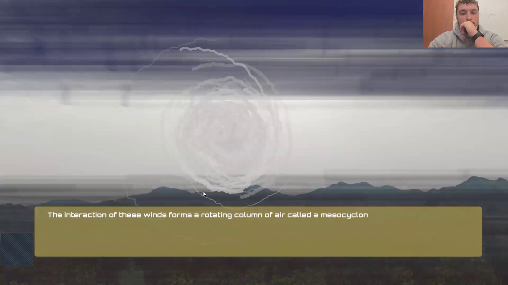

# STORM: Identifying Explainable Behavioral Indicators of Engagement and Confusion in Virtual Reality Learning Environments

*Ashik Dey Rupak | Computer Science Capstone | Truman State University*

## 1. Detailed Description of My Capstone Experience

For my capstone project, I worked on STORM, an interactive learning program developed in Unity that teaches users how tornadoes form, where they commonly occur, and how to respond safely during a tornado. The program combines educational lessons, quizzes, and a simulated emergency in which the participant must navigate to a shelter. Our goal was to understand how people learn and behave while interacting with this environment.

*Figure 1. STORM geography lesson showing the interactive map of the United States.*