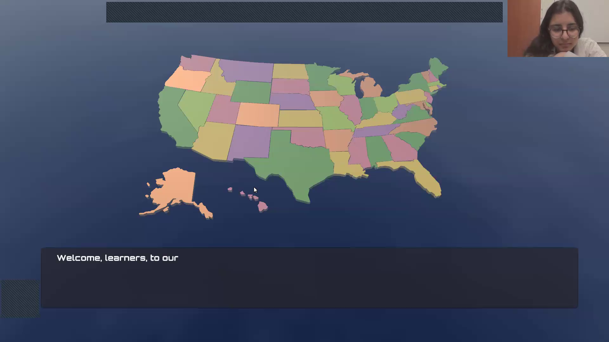
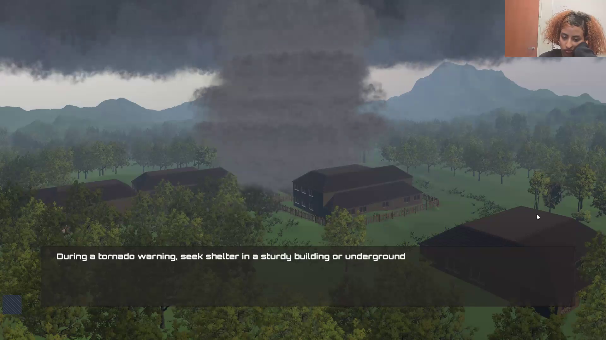
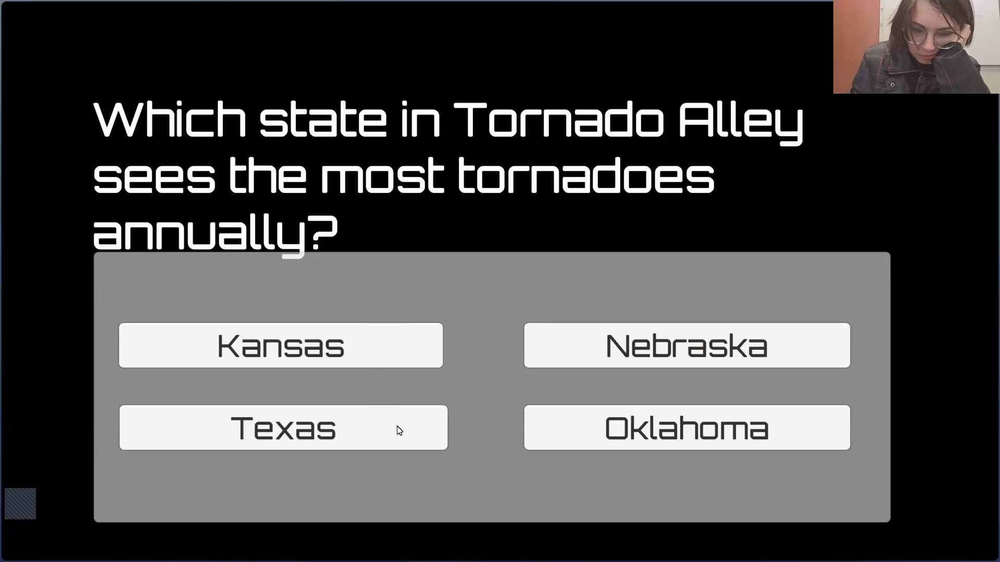
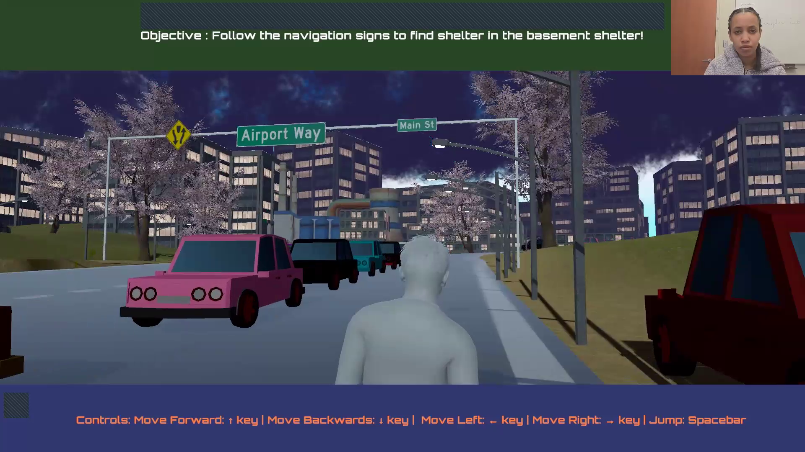
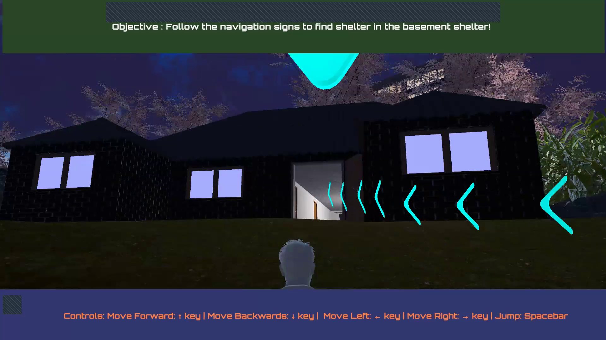

# Storm: Finding Explainable Behavioral Signs of Engagement and Confusion in a VR Learning Program

*Ashik Dey Rupak — Capstone Report (RQ2)*

## 1. Detailed Description of My Capstone Experience

For my capstone project, I worked on Storm, an interactive Unity virtual-reality program that teaches how tornadoes form, where they happen, and how to stay safe. Storm was a joint capstone with my partner Shalin Bhattarai. We shared the same VR system, but each of us owned a separate research question. Shalin studied whether spatial and timing patterns inside the simulation could predict learning outcomes. My research question, RQ2, asked which explainable behavioral features are most indicative of cognitive engagement and confusion in immersive VR learning environments.

The project started from a written proposal that assumed the Storm app would produce detailed in-app telemetry logs — timestamps of where each learner looked, which objects they touched, and how long they spent in each part of the simulation. When I began the analysis work, I discovered that the app had actually been run without any of that logging enabled. There were no interaction logs, no event timestamps, and no in-app behavior records at all. The only behavioral record of each session was a set of Zoom screen recordings: one video per participant showing the fullscreen VR application, a small webcam overlay of the participant in the corner, and a Zoom auto-generated transcript of the narration and the post-session interview.

That discovery changed the whole shape of my project. Instead of analyzing clean event logs, I had to treat twenty screen recordings as my dataset. Each recording was roughly an hour of compressed video, and the behavioral signals I wanted — how long someone spent in each lesson, whether they looked away, how still they sat, whether they were frowning — were all locked inside pixels. My job became building a pipeline that could recover those signals from video and transcripts, join them to survey-based labels of engagement and confusion, and then ask honestly what the data could and could not support.

The first major obstacle was the data itself. All the recordings had been shared as one large ZIP archive of about five gigabytes, and the archive was damaged — its central directory was corrupt, so every standard unzip tool failed. I wrote a custom extractor that scanned the raw bytes for local file headers, recorded each entry's offset, and copied the data regions directly out of the archive, carefully handling the data descriptors that mark where each file ends. That script recovered twenty MP4 and VTT pairs that would otherwise have been lost.

Once the recordings were recovered, the next step was turning them into structured data. Zoom's auto-transcripts contain narration cues with timestamps, and phrases like "welcome to the tornado formation lesson" act as landmarks for each phase of the session. I wrote a segmentation script that fused those transcript landmarks with a per-second frame signature — mostly detecting when the screen shows the white Zoom desktop, which marks the end of the app portion — to divide each recording into phases: pre-app, lesson one, quiz one, lesson two, the impacts lesson, the survival phone call, survival navigation, the final quiz, and the post-app interview. Some sessions broke the assumptions: one participant restarted the app mid-recording, one transcript started four minutes late, one recording was truncated with no transcript at all, and one participant replayed the survival scenario after failing it. Each of these cases had to be detected and handled explicitly rather than averaged away.

The phases above are not hypothetical — every recording walks through the same arc. The frames below show that arc across six different participants: lesson one (P12), lesson two (P14), the impacts lesson (P10), quiz one (P05), the survival phone call (P11), and survival navigation (P09). Each frame is the fullscreen application with the participant's webcam overlay in the corner — the only behavioral record that existed.

For labels, I processed three survey exports. The pre-survey gave a ten-item knowledge score. The post-surveys gave the same knowledge items plus a game-experience scale called GUESS and a cognitive-load scale. I built composites for engagement and confusion, reverse-coded the item where agreement actually meant less engagement, fuzzy-matched participant names between surveys and recordings because of typos on both sides, and even handled a misspelled survey label ("strongy agree") that would otherwise have silently scored as missing. Every missing value was kept as NaN rather than zero, because "we did not observe this" is not the same as "this did not happen" — that convention ended up being one of the most important decisions in the project.

With phases and labels in place, I extracted behavioral features. Timing features measured how long each phase lasted and how many attempts a participant made at the survival scenario. Webcam features measured motion energy, stillness, and the longest motionless streak. Then I added machine-learning-derived features: MediaPipe's FaceLandmarker ran on the webcam overlay once per second, estimating head yaw, pitch, and roll, face presence, and sixteen facial action units such as brow raise, frown, jaw drop, and smile. Because camera mounting differed between participants — one person sat at a steep downward pitch, another had the overlay off entirely — I normalized head-pose features against each participant's own median rather than using absolute thresholds, and treated near-zero face detection as missing data.

The analysis itself was deliberately modest. With about twenty-one usable participants, I computed Spearman rank correlations between every behavioral feature and every outcome, then tried regularized linear models with leave-one-out cross-validation. The correlations produced several interpretable signals: time spent in the first lesson predicted post-test knowledge scores, looking away from the screen predicted lower reported effort, and frowning and mouth-stretch facial activation