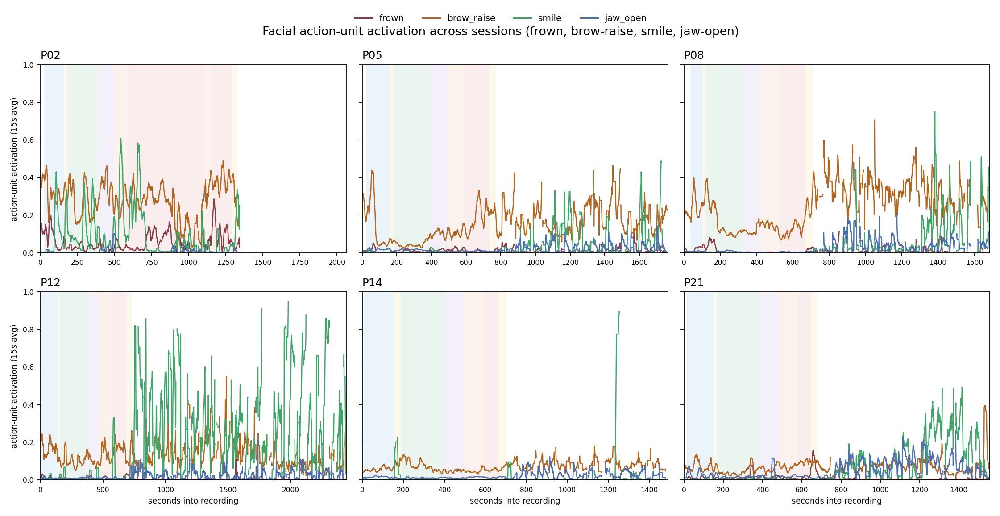
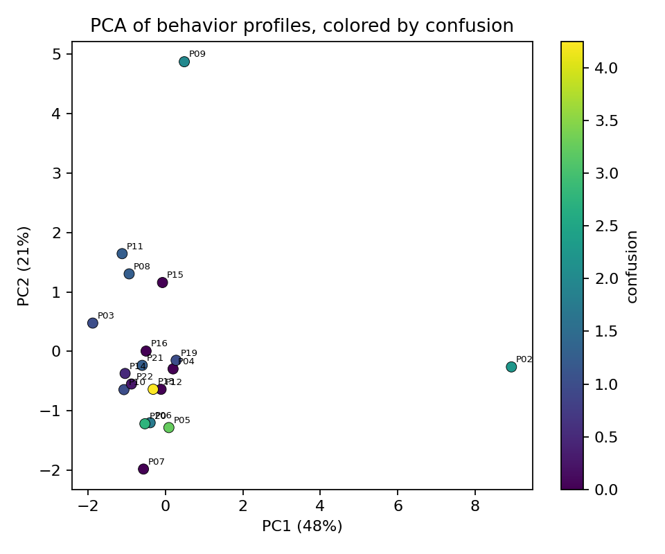

# STORM: Identifying Explainable Behavioral Indicators of Engagement and Confusion in Virtual Reality Learning Environments

*Ashik Dey Rupak | Computer Science Capstone | Truman State University*

## 1. Detailed Description of My Capstone Experience

For my capstone project, I worked on STORM, an interactive learning program developed in Unity that teaches users how tornadoes form, where they commonly occur, and how to respond safely during a tornado. The program combines educational lessons, quizzes, and a simulated emergency in which the participant must navigate to a shelter. Our goal was to understand how people learn and behave while interacting with this environment.

*Figure 1. STORM geography lesson showing the interactive map of the United States.*

I worked with my project partner, Shalin Bhattarai, and we focused on different research questions. My research question (RQ2) was: Which explainable behavioral features are indicative of cognitive engagement and confusion in immersive VR learning environments? I wanted to determine whether observable behaviors, such as time spent on lessons, navigation difficulties, head movement, and facial expressions, could provide useful information about a learner's experience.

*Figure 2. Example of an in-app multiple-choice knowledge question.*

The study involved 21 participants and 21 video recordings. The recordings provided the basis for extracting behavioral data, which was combined with survey responses. The original plan was to use interaction logs from the application, but the application did not produce those logs. Instead, I had to work with Zoom screen recordings, webcam footage, and available automatic transcripts. This changed my project from a conventional data analysis task into a video processing and feature extraction problem.

The first challenge was recovering the recordings from a damaged archive. Standard extraction tools could not read the archive correctly because its central directory was corrupted. I developed a Python script that searched for local ZIP file headers and recovered accessible video and transcript entries. This allowed the analysis to proceed without relying on the damaged archive index.

After recovering the available files, I developed a segmentation pipeline to identify the different stages of the learning experience. I used timestamps from narration in the transcripts and visual information from video frames sampled at one frame per second. The program divided sessions into lessons, quizzes, the survival phone call, navigation, and the post-session interview. I also handled unusual cases such as an application restart, incomplete transcripts, and repeated survival attempts. Missing observations were kept separate from actual zero values.

Once the sessions were segmented, I extracted features that represented different aspects of participant behavior. These included total session duration, time spent in each lesson, navigation duration, number of survival attempts, quiz feedback, participant speech, and webcam movement. I stored these measurements in CSV files using participant identifiers instead of names. This made the information easier to analyze and helped protect participant privacy.

*Figure 3. Shelter-seeking task with on-screen navigation signs and controls.*

Another important part of my project was computer vision. I used MediaPipe FaceLandmarker to estimate head orientation and facial action units from the webcam overlay. Head orientation included yaw, pitch, and roll. I calculated how often a participant's head position deviated from their own typical position as an approximate measure of looking away. Using an individual baseline helped reduce the effect of differences in camera placement and sitting position.

The facial features included brow movement, blinking, frowning, mouth stretching, and jaw movement. These were numerical estimates rather than direct measurements of emotions. Because the webcam images were small and sometimes unavailable, I treated facial measurements as noisy behavioral indicators. A frown alone does not prove that someone is confused, and head orientation is not the same as eye tracking.

To examine how these signals changed over time, I compared facial action-unit activation across six example sessions. The graph shows 15-second averages of frowning, brow raising, smiling, and jaw opening. The patterns vary across participants and recording phases, illustrating why individual behavior and recording context must be considered when interpreting these measurements. The signals do not directly establish a participant's emotional state.

*Figure 4. Facial action-unit activation across six example sessions (P02, P05, P08, P12, P14, and P21), using 15-second averages.*

I then combined the extracted features with survey measures of engagement, effort, confusion, and knowledge. Pre-test and post-test scores allowed me to examine learning outcomes. I used Spearman correlation to explore relationships between behavior and survey responses, because it measures the strength of a monotonic relationship without requiring a linear relationship.

The existing analysis showed several interesting patterns. Looking away more frequently was associated with lower reported effort, while frowning and mouth stretching were associated with higher reported confusion. Longer time in the first lesson was associated with higher post-test scores. These relationships are exploratory and should not be interpreted as proof that one behavior causes another outcome.

Navigation during the survival scenario was another major finding. In the documented analysis, navigation duration ranged from about 70 to 633 seconds. Some participants reported that the controls or instructions were confusing. One participant struggled for several minutes before the scenario repeated and was completed on a second attempt. This showed how video timing and interview feedback could be used together to identify a possible usability problem.

*Figure 5. Original project plot: navigation duration versus reported confusion (Spearman rho = 0.25, p = 0.296).*

For the machine learning portion, I used LASSO regression and logistic regression with leave-one-out cross-validation. This approach allowed the model to be evaluated on a participant who was not included in that training fold. The documented regression results were below the mean-prediction baseline, and the binary confusion classifier achieved approximately 67% accuracy compared with a 76% majority-class baseline. Therefore, the current results do not support reliable prediction of engagement or confusion from these features alone.

*Figure 6. Original project PCA plot, colored by reported confusion. The first two components explain 67% of the variance.*

I also used principal component analysis (PCA) to visualize similarities and differences among participant behavior profiles. Figure 6 shows that the profiles do not form clearly separated confusion groups; P02 is a notable outlier. This visualization is exploratory and does not establish a reliable classifier.

I also developed verification scripts to check data formats, participant identifiers, missing values, numerical ranges, and the reproducibility of the reported correlations. The repository records 114 successful artifact and transcript checks. These checks helped identify inconsistencies in the processing pipeline, although passing them does not establish that every measurement is accurate. The final outcome was an explainable analysis pipeline and a set of preliminary findings that can guide future research on VR learning.

## 2. Physical, Social, and Development Environment

My development work was primarily computer-based and involved processing recorded sessions, writing Python scripts, examining data, and interpreting results. The research environment included collaboration with my project partner and faculty guidance. I used the project repository to organize code, derived datasets, figures, and documentation. Since video processing and testing took time, I separated the pipeline into smaller scripts and cached intermediate results so I could make changes without repeatedly processing every video.

## 3. How Much I Worked With Other People

Although STORM was a group capstone, my main responsibility was RQ2, while Shalin focused on RQ1. We worked with the same learning environment and research data, but our individual analyses addressed different questions. I was responsible for developing the behavioral feature extraction and